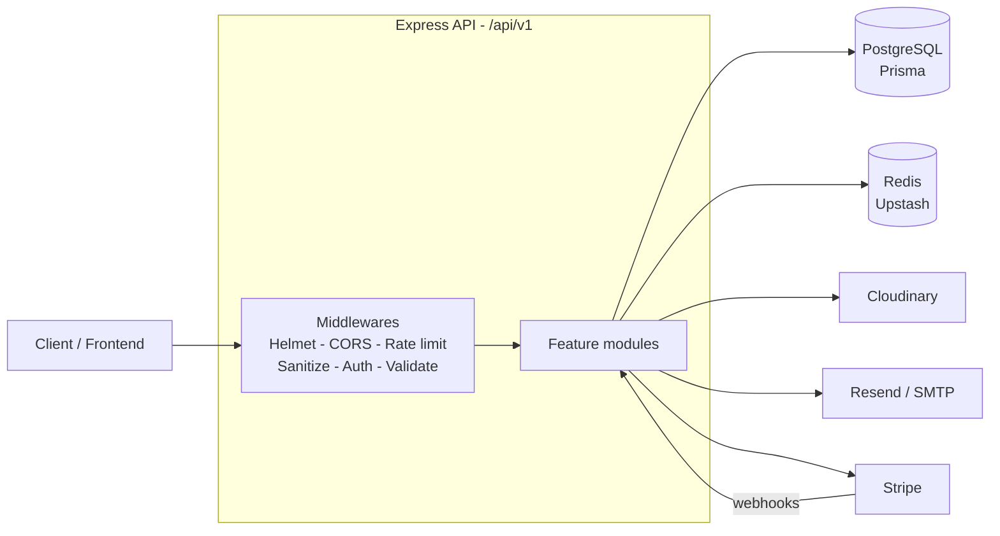

<div align="center">

<!-- Replace with your logo: place it at docs/logo.png -->


# Evalora API

### Production-grade backend for a modern developer assessment platform

Create coding, MCQ and written assessments, invite candidates, grade submissions and rank results — through a secure, multi-tenant REST API.

<br />

[](https://evalora-server.vercel.app)
[](https://evalora-server.vercel.app/api-docs)
[](https://evalora-client.vercel.app)


[**Live Links**](#-live-links) ·
[**Demo Access**](#-demo-access) ·
[**Features**](#-features) ·
[**Architecture**](#-architecture) ·
[**API Reference**](#-api-reference) ·
[**Local Setup**](#-local-setup)

</div>

---

## 📑 Table of Contents

- [Overview](#-overview)
- [Live Links](#-live-links)
- [Demo Access](#-demo-access)
- [Features](#-features)
- [Tech Stack](#-tech-stack)
- [Architecture](#-architecture)
- [Project Structure](#-project-structure)
- [Local Setup](#-local-setup)
- [API Reference](#-api-reference)
- [Roles & Access](#-roles--access)
- [File Uploads](#-file-uploads)
- [Response Format](#-response-format)
- [Scripts](#-scripts)
- [Security](#-security)
- [License](#-license)

---

## ✨ Overview

**Evalora API** powers the Evalora assessment platform. Recruiters build assessments from a reusable problem bank, invite candidates by email, and evaluate submissions through a hybrid of **automatic MCQ grading** and **manual review** for coding and written answers. Candidates take timed attempts with proctoring signals recorded for human review, and results are ranked on a live leaderboard.

| | |
|---|---|
| **Style** | RESTful JSON API under `/api/v1` |
| **Auth** | Better Auth — email/password, Google & GitHub OAuth, email OTP |
| **Roles** | `ADMIN` · `RECRUITER` · `CANDIDATE` |
| **Validation** | Zod schemas on every input, including environment config |
| **Docs** | Interactive API documentation at `/api-docs` |

---

## 🔗 Live Links

| Resource | URL |
|---|---|
| 🌐 Frontend | https://evalora-client.vercel.app |
| ⚙️ Backend | https://evalora-server.vercel.app |
| 📘 API Documentation | https://evalora-server.vercel.app/api-docs |

---

## 🔑 Demo Access

| Role | Email | Password |
|---|---|---|
| 👔 Recruiter | `candidate2@demo.com` | `Candidate@123` |
| 🧑‍💻 Candidate | `candidate1@demo.com` | `Candidate@123` |
| 🛡️ Admin | _Available on request_ | — |

> Demo accounts are created by `pnpm seed`.

---

## 🚀 Features

| | Feature | Description |
|---|---|---|
| 🔐 | **Multi-role authentication** | Admin, Recruiter and Candidate with role-based access control |
| 🧪 | **Assessment builder** | MCQ, Coding and Written problem types from a reusable problem bank |
| 🕘 | **Version control** | Assessment versioning with restore capability |
| ✉️ | **Candidate invitations** | Email-based flow with accept / decline |
| ⏱️ | **Timed attempts** | Time-boxed attempts with auto-submit |
| 👁️ | **Proctoring events** | Tab-switch detection and event logging |
| ✅ | **Hybrid evaluation** | Auto-graded MCQ plus manual grading for coding / written |
| 🏆 | **Results & rankings** | Score computation, leaderboards and rank calculation |
| 💳 | **Subscription billing** | Stripe integration for PRO plan upgrades |
| 🏢 | **Company verification** | Admin-verified company profiles |
| 📜 | **GDPR consents** | Marketing and analytics consent management |
| 🔔 | **Notifications** | In-app notifications with read / unread tracking |
| 📎 | **File uploads** | Avatars, logos and resumes via Cloudinary |
| 📧 | **Email OTP** | Password reset and email verification via Resend / SMTP |
| 🔑 | **OAuth login** | Google and GitHub authentication |

---

## 🧰 Tech Stack

| Layer | Technologies |
|---|---|
| **Runtime & Framework** | Node.js · Express 5 · TypeScript |
| **Database** | PostgreSQL · Prisma ORM |
| **Authentication** | Better Auth (email/password + Google / GitHub OAuth) |
| **Payments** | Stripe (checkout sessions, webhooks) |
| **Email** | Resend (primary) · Nodemailer / SMTP (fallback) |
| **File storage** | Cloudinary |
| **Caching & rate limiting** | Redis (Upstash) |
| **Validation** | Zod |
| **Security** | Helmet · CORS · rate limiting · body sanitization · optional hCaptcha |
| **Tooling** | Biome · pnpm |

---

## 🏗️ Architecture



Every module follows the same layered pattern — **route → validation → controller → service → Prisma** — so each feature stays isolated, testable and easy to extend.

---

## 📁 Project Structure

```
src/
├── app/
│   ├── config/           # Environment config (Zod validated)
│   ├── middlewares/      # Auth, upload, rate-limit, validation
│   ├── modules/          # Feature modules
│   │   ├── auth/         # Authentication (Better Auth)
│   │   ├── user/         # User management
│   │   ├── company/      # Company & subscriptions
│   │   ├── problem/      # Problem bank (MCQ, Coding, Written)
│   │   ├── assessment/   # Assessments & versions
│   │   ├── candidate/    # Candidate profiles
│   │   ├── attempt/      # Assessment attempts
│   │   ├── evaluation/   # Submission evaluation
│   │   ├── result/       # Results & rankings
│   │   ├── invitation/   # Candidate invitations
│   │   ├── payment/      # Stripe payments
│   │   ├── notification/ # In-app notifications
│   │   ├── consent/      # GDPR / privacy consents
│   │   ├── admin/        # Admin dashboard
│   │   └── webhook/      # Stripe webhooks
│   └── routes/           # Route aggregation
├── lib/                  # Prisma, Cloudinary, Stripe, Redis clients
├── app.ts                # Express app setup
└── server.ts             # Server entry point
```

---

## 🏁 Local Setup

**Prerequisites:** Node.js 20+, pnpm, PostgreSQL, and credentials for Redis, Stripe, Cloudinary and an email provider.

```bash
# 1. Clone & install
git clone <backend-repo>
cd <backend>
pnpm install

# 2. Configure environment
cp .env.example .env
# edit .env with your credentials

# 3. Prepare the database
pnpm generate      # Generate Prisma client
pnpm migrate       # Run migrations
pnpm seed          # Seed demo accounts

# 4. Start the server
pnpm dev           # http://localhost:5000
```

Then run the frontend (separate repo):

```bash
git clone <frontend-repo>
cd <frontend>
pnpm install
pnpm dev           # http://localhost:3000
```

> 💡 `pnpm db:setup` runs generate + migrate + seed in one step.

---

## 📡 API Reference

**Base URL:** `/api/v1` — all paths below are prefixed with it. Full interactive docs: [`/api-docs`](https://evalora-server.vercel.app/api-docs).

<details>
<summary><b>Health</b></summary>

| Method | Path | Description |
|---|---|---|
| GET | `/` | API status |
| GET | `/health` | Health check (DB connectivity) |

</details>

<details>
<summary><b>Authentication</b> — <code>/auth</code></summary>

Better Auth handles its own routes automatically under `/api/auth/*splat`. **OAuth:** Google, GitHub.

| Method | Path | Description |
|---|---|---|
| POST | `/auth/register` | Register new user |
| POST | `/auth/login` | Login |
| POST | `/auth/logout` | Logout 🔒 |
| POST | `/auth/refresh-token` | Refresh session 🔒 |
| POST | `/auth/send-otp` | Send email OTP |
| POST | `/auth/verify-email-otp` | Verify email OTP |
| POST | `/auth/reset-password-otp` | Reset password with OTP |
| POST | `/auth/change-password` | Change password 🔒 |
| GET | `/auth/me` | Get current user 🔒 |

</details>

<details>
<summary><b>Users</b> — <code>/users</code></summary>

| Method | Path | Access | Description |
|---|---|---|---|
| PATCH | `/users/me` | Any | Update own profile (image upload) |
| GET | `/users/me/export` | Any | Export own data (GDPR) |
| POST | `/users/me/delete` | Any | Delete own account |
| GET | `/users/` | Admin | List all users |
| GET | `/users/:id` | Admin | Get user by ID |
| PATCH | `/users/:id/role` | Admin | Update user role |
| PATCH | `/users/:id/status` | Admin | Update user status |
| DELETE | `/users/:id` | Admin | Delete user |

</details>

<details>
<summary><b>Companies</b> — <code>/companies</code></summary>

| Method | Path | Access | Description |
|---|---|---|---|
| POST | `/companies/register` | Any | Register company (promotes to RECRUITER) |
| GET | `/companies/` | Public | List verified companies |
| GET | `/companies/:id` | Public | Get company by ID |
| GET | `/companies/me` | Any | Get own company |
| PATCH | `/companies/me` | Recruiter | Update company (logo upload) |
| POST | `/companies/me/request-verification` | Recruiter | Request admin verification |
| PATCH | `/companies/:id/verify` | Admin | Verify company |
| DELETE | `/companies/:id` | Any | Delete company |
| GET | `/companies/me/subscription` | Recruiter | Get subscription |
| PATCH | `/companies/me/subscription` | Recruiter | Update subscription |
| POST | `/companies/me/subscription/cancel` | Recruiter | Cancel subscription |

</details>

<details>
<summary><b>Problems</b> — <code>/problems</code></summary>

| Method | Path | Access | Description |
|---|---|---|---|
| POST | `/problems/` | Recruiter | Create problem |
| GET | `/problems/` | Recruiter / Admin | List problems |
| GET | `/problems/:id` | Recruiter / Admin | Get problem |
| PATCH | `/problems/:id` | Recruiter | Update problem |
| DELETE | `/problems/:id` | Recruiter | Delete problem |

</details>

<details>
<summary><b>Assessments</b> — <code>/assessments</code></summary>

| Method | Path | Access | Description |
|---|---|---|---|
| POST | `/assessments/` | Recruiter | Create assessment |
| GET | `/assessments/` | Recruiter / Admin | List assessments |
| GET | `/assessments/:id` | Recruiter / Admin | Get assessment |
| PATCH | `/assessments/:id` | Recruiter | Update assessment (DRAFT only) |
| PATCH | `/assessments/:id/publish` | Recruiter | Publish assessment |
| PATCH | `/assessments/:id/close` | Recruiter | Close assessment |
| DELETE | `/assessments/:id` | Recruiter | Delete assessment |
| POST | `/assessments/:id/versions` | Recruiter | Create new version |
| GET | `/assessments/:id/versions` | Recruiter / Admin | List versions |
| PATCH | `/versions/:id/restore` | Recruiter | Restore old version |

</details>

<details>
<summary><b>Candidates</b> — <code>/candidates</code></summary>

| Method | Path | Access | Description |
|---|---|---|---|
| GET | `/candidates/me` | Candidate | Get own profile |
| PATCH | `/candidates/me` | Candidate | Update profile (resume upload) |
| GET | `/candidates/` | Recruiter / Admin | List candidates |
| GET | `/candidates/:id` | Recruiter / Admin | Get candidate profile |

</details>

<details>
<summary><b>Attempts</b> — <code>/attempts</code></summary>

| Method | Path | Access | Description |
|---|---|---|---|
| POST | `/attempts/start` | Candidate | Start assessment attempt |
| GET | `/attempts/me` | Candidate | List my attempts |
| GET | `/attempts/:id` | Any | Get attempt |
| PUT | `/attempts/:id/submissions/:problemId` | Candidate | Save submission |
| POST | `/attempts/:id/submit` | Candidate | Submit attempt |
| POST | `/attempts/:id/proctoring-events` | Candidate | Record proctoring event |
| GET | `/attempts/:id/proctoring-events` | Any | List proctoring events |
| GET | `/attempts/:id/proctoring-events/:eventId` | Any | Get single proctoring event |

</details>

<details>
<summary><b>Evaluations</b> — <code>/evaluations</code></summary>

| Method | Path | Access | Description |
|---|---|---|---|
| GET | `/evaluations/attempts/:attemptId/submissions` | Recruiter / Admin | Get submissions |
| GET | `/evaluations/assessments/:assessmentId/pending` | Recruiter / Admin | Get pending evaluations |
| GET | `/evaluations/submissions/:id` | Recruiter / Admin | Get submission |
| PATCH | `/evaluations/submissions/:id` | Recruiter / Admin | Evaluate submission |

</details>

<details>
<summary><b>Results</b> — <code>/results</code></summary>

| Method | Path | Access | Description |
|---|---|---|---|
| GET | `/results/attempts/:attemptId` | Any | Get result by attempt |
| GET | `/results/assessments/:assessmentId` | Recruiter / Admin | Results for an assessment |
| POST | `/results/assessments/:assessmentId/compute-ranks` | Recruiter | Compute ranks |
| PATCH | `/results/assessments/:assessmentId/release` | Recruiter | Release results to candidates |

</details>

<details>
<summary><b>Invitations</b> — <code>/invitations</code></summary>

| Method | Path | Access | Description |
|---|---|---|---|
| POST | `/invitations/assessments/:assessmentId` | Recruiter | Invite candidates |
| GET | `/invitations/assessments/:assessmentId` | Recruiter / Admin | List invitations |
| GET | `/invitations/me` | Candidate | My invitations |
| GET | `/invitations/:id` | Any | Get invitation |
| POST | `/invitations/:id/accept` | Candidate | Accept invitation |
| POST | `/invitations/:id/decline` | Candidate | Decline invitation |
| DELETE | `/invitations/:id` | Recruiter | Cancel invitation |

</details>

<details>
<summary><b>Payments</b> — <code>/payments</code></summary>

| Method | Path | Access | Description |
|---|---|---|---|
| POST | `/payments/checkout` | Recruiter | Create Stripe checkout session |
| GET | `/payments/me` | Recruiter | My payments |
| GET | `/payments/` | Admin | All payments |
| GET | `/payments/:id` | Any | Get payment |
| POST | `/payments/:id/sync` | Recruiter / Admin | Sync payment status with Stripe |

</details>

<details>
<summary><b>Notifications</b> — <code>/notifications</code></summary>

| Method | Path | Access | Description |
|---|---|---|---|
| GET | `/notifications/me` | Any | My notifications |
| GET | `/notifications/unread-count` | Any | Unread count |
| PATCH | `/notifications/read-all` | Any | Mark all as read |
| PATCH | `/notifications/:id/read` | Any | Mark as read |
| DELETE | `/notifications/:id` | Any | Delete notification |

</details>

<details>
<summary><b>Admin, Consents & Webhooks</b></summary>

| Method | Path | Access | Description |
|---|---|---|---|
| GET | `/admin/dashboard-stats` | Admin | Dashboard statistics |
| GET | `/admin/audit-logs` | Admin | Audit logs |
| GET | `/consents/me` | Any | My consents |
| PATCH | `/consents/me` | Any | Update consent |
| DELETE | `/consents/me/:consentType` | Any | Revoke consent |
| POST | `/webhooks/stripe` | Stripe | Stripe webhook handler |

</details>

🔒 = authentication required.

---

## 👥 Roles & Access

| Role | Description |
|---|---|
| `CANDIDATE` | Takes assessments and manages their own profile |
| `RECRUITER` | Creates problems and assessments, invites candidates, manages the company |
| `ADMIN` | Full access — user management, company verification, dashboard and audit logs |

---

## 📎 File Uploads

| Field | Route | Max size | Destination |
|---|---|---|---|
| `image` | `PATCH /users/me` | 5 MB | Cloudinary `avatars/` |
| `logo` | `PATCH /companies/me` | 5 MB | Cloudinary `company-logos/` |
| `resume` | `PATCH /candidates/me` | 20 MB | Cloudinary `resumes/` |

---

## 📦 Response Format

**Success**

```json
{
  "success": true,
  "message": "Operation successful.",
  "data": { }
}
```

**Error**

```json
{
  "success": false,
  "message": "Error description.",
  "errors": [],
  "errorCode": "ERROR_CODE"
}
```

---

## 🛠️ Scripts

| Command | Description |
|---|---|
| `pnpm dev` | Start dev server with hot reload |
| `pnpm build` | Build for production |
| `pnpm start` | Start production server |
| `pnpm seed` | Seed database |
| `pnpm generate` | Generate Prisma client |
| `pnpm migrate` | Run migrations |
| `pnpm migrate:deploy` | Deploy migrations |
| `pnpm studio` | Open Prisma Studio |
| `pnpm reset` | Reset database |
| `pnpm db:setup` | Full DB setup (generate + migrate + seed) |
| `pnpm lint` | Run Biome linter |
| `pnpm lint:fix` | Fix lint issues |
| `pnpm format` | Format code |

---

## 🛡️ Security

- **Helmet** secure HTTP headers and strict **CORS**
- **Redis-backed rate limiting** (Upstash)
- **Request body sanitization** and **Zod validation** on every input
- **Environment validation** — the server refuses to boot with invalid config
- **Role-based access control** on every protected route
- **Better Auth** sessions, email OTP verification and OAuth
- **Optional hCaptcha** for abuse protection
- **Audit logs** for administrative and security-relevant actions
- **GDPR tooling** — consent management, data export and account deletion

---

## 📄 License

Distributed under the **MIT License**.

<div align="center">

<br />

Built with ❤️ using Express, Prisma & TypeScript

[Live API](https://evalora-server.vercel.app) · [API Docs](https://evalora-server.vercel.app/api-docs) · [Frontend](https://evalora-client.vercel.app)

</div>